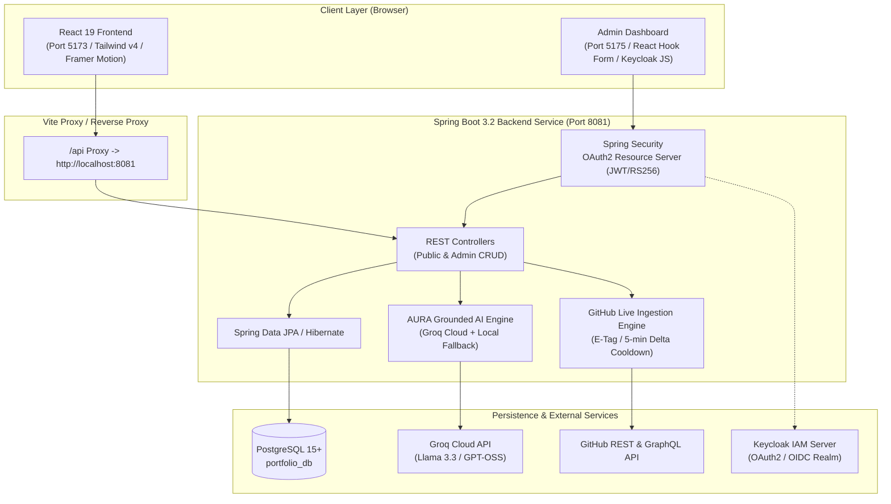

<div align="center">

# ⚡ Sid Portfolio

**Production-Grade Distributed Engineering Showcase & Applied AI Ecosystem**

[](https://www.oracle.com/java/)
[](https://spring.io/projects/spring-boot)
[](https://react.dev/)
[](https://tailwindcss.com/)
[](https://www.postgresql.org/)
[](https://vitejs.dev/)
[](https://groq.com/)
[](LICENSE)

<p align="center">
  A high-performance personal engineering platform featuring an obsidian luxury UI, real-time GitHub repository and contribution sync, an interactive aerospace chronometer skills radar, and AURA—a context-grounded AI assistant powered by Groq Cloud.
</p>

[Explore Live Demo](https://github.com/musxsid/Sid_Portfolio) • [Report Issue](https://github.com/musxsid/Sid_Portfolio/issues) • [API Documentation](#-rest-api-reference)

---

</div>

## 📌 Table of Contents

- [System Architecture](#-system-architecture)
- [Key Features](#-key-features)
- [Technology Stack](#-technology-stack)
- [Project Directory Structure](#-project-directory-structure)
- [Getting Started & Local Execution](#-getting-started--local-execution)
  - [Prerequisites](#prerequisites)
  - [Step 1: Database Setup](#step-1-database-setup)
  - [Step 2: Backend Configuration & Startup](#step-2-backend-configuration--startup)
  - [Step 3: Frontend Startup](#step-3-frontend-startup)
  - [Step 4: Admin Panel Startup (Optional)](#step-4-admin-panel-startup-optional)
  - [One-Click Startup (Windows)](#one-click-startup-windows)
- [Environment Configuration](#-environment-configuration)
- [REST API Reference](#-rest-api-reference)
- [License & Author](#-license--author)

---

## 🏛 System Architecture

The application is structured into decoupled microservices and clients:



---

## ✨ Key Features

### 1. ⚡ Aerospace Chronometer Arsenal (Skills Radar)
- 4-station circular radar dial powered by SVG trigonometry and coordinate geometry.
- Snappy "poppy" spring animations with `<AnimatePresence mode="wait">` that eliminate text overlap.
- Granular categorized engineering dossiers: **Backend Architecture**, **Applied AI & Structured RAG**, **Frontend Engineering & UI**, and **Cloud, Databases & DevOps**.
- Verified production evidence linking directly to GitHub repositories.

### 2. 🤖 AURA Grounded AI Co-Pilot
- Direct chat dialog grounded on resume dossiers, project architectures, and engineering metrics.
- Accelerated with Groq Cloud LLM inference (`Llama 3.3 70B` / `GPT-OSS`).
- Built-in zero-latency deterministic fallback knowledge engine ensuring 100% uptime even without an external API token.

### 3. 📊 Real-Time GitHub Ingestion & Dynamic Heatmap
- Live GitHub repository fetcher with automated image discovery and fallback preview generation.
- Dynamic 52-week contribution heatmap displaying real commit volumes, streaks, and repository telemetry.
- 5-minute memory cache and delta cooldown guards to preserve external GitHub rate limits.

### 4. 📄 Dynamic Resume Ingestion Pipeline
- Custom Vite development middleware and build hooks that serve and stream the latest PDF resume from either `frontend/resume/` or `frontend/public/resume/`.
- Embedded inline viewer and one-click direct download button.

### 5. 🎨 Dark Obsidian Luxury UI & Kinetic Physics
- Hardware-accelerated canvas particle and cursor spotlight shaders.
- Responsive kinetic typography with scroll-linked color transitions (e.g. `Selected Work.` morphing smoothly into amber accents).
- High-efficiency design system styled entirely with Tailwind CSS v4 and Framer Motion 12.

### 6. 🔐 Headless Admin CMS & Lead Capture
- Protected CRUD endpoints managed via Spring Security OAuth2 resource server with RS256 JWT validation.
- Full administration over projects, experiences, skill inventories, and incoming client consultation leads.

---

## 🛠 Technology Stack

| Domain | Technologies |
| :--- | :--- |
| **Frontend Client** | React 19, Tailwind CSS 4, Framer Motion 12, Vite 8, Lucide Icons, Axios |
| **Backend Service** | Java 17/21, Spring Boot 3.2, Spring Security 6, Spring Data JPA, Hibernate, Lombok |
| **Database** | PostgreSQL 15+ (ACID relational storage with automated schema update) |
| **AI & Telemetry** | Groq Cloud API (`openai/gpt-oss-120b`, `llama-3.3-70b-versatile`), GitHub REST API |
| **Admin Panel** | React 19, React Router 7, Keycloak JS, React Hook Form, Zod, Recharts |
| **Tooling & Build** | Maven Wrapper (`mvnw`), npm, Oxlint, PowerShell |

---

## 📁 Project Directory Structure

```text
Sid_Portfolio/
├── backend/                             # Spring Boot 3 Java Service
│   ├── src/
│   │   ├── main/
│   │   │   ├── java/com/portfolio/backend/
│   │   │   │   ├── config/              # Security & Web MVC configurations
│   │   │   │   ├── controller/          # PublicPortfolioController & AdminCrudController
│   │   │   │   ├── dto/                 # Request/Response Data Transfer Objects
│   │   │   │   ├── entity/              # JPA Domain Entities (Project, Skill, Lead, etc.)
│   │   │   │   ├── repository/          # Spring Data JPA Repositories
│   │   │   │   └── service/             # GitHubService, GroqAiService, ProjectService, etc.
│   │   │   └── resources/
│   │   │       ├── application.yml      # Master configuration profile
│   │   │       └── static/              # Static assets & dynamic screenshots
│   │   └── test/                        # Integration & Unit test suites
│   ├── .env.example                     # Backend environment template
│   ├── mvnw.cmd / mvnw                  # Maven Wrapper executables
│   └── pom.xml                          # Maven build dependencies
│
├── frontend/                            # React 19 + Tailwind v4 + Vite Application
│   ├── public/                          # Public static files, favicon, and resume
│   ├── resume/                          # Hot-reloadable directory for resume PDF
│   ├── src/
│   │   ├── assets/                      # Icons, graphic assets, and fallback images
│   │   ├── components/                  # Navbar, Hero, Skills (Arsenal), Projects, AURA, Footer
│   │   ├── data/                        # Static fallback data, skills, and resume definitions
│   │   ├── services/                    # Axios API client & error boundaries
│   │   ├── App.jsx                      # Root application layout & scroll-linked shaders
│   │   └── index.css                    # Obsidian design tokens & Tailwind imports
│   ├── .env.example                     # Frontend environment template
│   ├── package.json                     # Frontend scripts and packages
│   └── vite.config.js                   # Vite config with custom PDF & asset middleware
│
├── admin/                               # React 19 Admin Portal (CRUD & Telemetry)
│   ├── src/                             # Admin views, Keycloak client, and analytics
│   └── package.json                     # Admin portal dependencies
│
├── start-all.bat                        # Windows 1-click startup automation script
├── .gitignore                           # Excludes target/, node_modules/, secrets, etc.
└── README.md                            # Executive Project Documentation
```

---

## 🚀 Getting Started & Local Execution

### Prerequisites

Ensure you have the following installed on your machine:
- **Java Development Kit (JDK)**: Version 17 or 21 ([Eclipse Temurin](https://adoptium.net/) or Oracle JDK)
- **Node.js**: Version 18.x or 20.x+ ([Node.js Official](https://nodejs.org/))
- **PostgreSQL**: Version 14+ ([PostgreSQL Official](https://www.postgresql.org/download/))
- **Git**: For version control

---

### Step 1: Database Setup

1. Open your PostgreSQL terminal (`psql`) or pgAdmin.
2. Create the application database:
   ```sql
   CREATE DATABASE portfolio_db;
   ```
3. By default, the backend connects to `jdbc:postgresql://localhost:5432/portfolio_db` using the username `postgres`. Ensure your password matches your local PostgreSQL setup (configured in `application.yml` or via `SPRING_DATASOURCE_PASSWORD`).

---

### Step 2: Backend Configuration & Startup

1. Open a terminal and navigate to the `backend` directory:
   ```bash
   cd backend
   ```
2. *(Optional)* Set custom environment variables (e.g. for Groq AI or GitHub sync):
   - **Windows (PowerShell)**:
     ```powershell
     $env:SPRING_DATASOURCE_PASSWORD="your_postgres_password"
     $env:GROQ_API_KEY="your_groq_api_key"           # Optional
     $env:GITHUB_TOKEN="your_github_token"           # Optional
     ```
   - **Linux / macOS**:
     ```bash
     export SPRING_DATASOURCE_PASSWORD="your_postgres_password"
     export GROQ_API_KEY="your_groq_api_key"
     export GITHUB_TOKEN="your_github_token"
     ```
3. Run the Spring Boot application using the Maven wrapper:
   - **Windows**:
     ```powershell
     .\mvnw.cmd spring-boot:run
     ```
   - **Linux / macOS**:
     ```bash
     ./mvnw spring-boot:run
     ```
4. The backend will boot and listen on **`http://localhost:8081`**.
   - JPA Hibernate will automatically create or update tables on first startup.
   - Verify health: Visit `http://localhost:8081/api/public/projects` in your browser.

---

### Step 3: Frontend Startup

1. Open a new terminal window and navigate to the `frontend` directory:
   ```bash
   cd frontend
   ```
2. Install dependencies:
   ```bash
   npm install
   ```
3. Start the Vite development server:
   ```bash
   npm run dev
   ```
4. Open your browser and navigate to:
   ```
   http://localhost:5173
   ```
   > **Note:** The Vite dev server has a built-in reverse proxy that routes any request to `/api/*` directly to `http://localhost:8081`. You do not need any additional CORS configuration for local development.

---

### Step 4: Admin Panel Startup (Optional)

The admin panel provides secured CRUD management over the portfolio:

1. Open a new terminal and navigate to `admin`:
   ```bash
   cd admin
   ```
2. Install dependencies and start the app:
   ```bash
   npm install
   npm run dev
   ```
3. Access the admin dashboard at **`http://localhost:5175`**.
   > **Note:** Secured admin operations utilize Keycloak JWT authentication. For local testing without Keycloak, the public frontend operates fully standalone.

---

### One-Click Startup (Windows)

If you are on Windows, you can start all services simultaneously:

1. Double-click `start-all.bat` or run:
   ```powershell
   .\start-all.bat
   ```
2. This launches separate command windows for Backend, Frontend, and Admin.

---

## ⚙️ Environment Configuration

### Backend Options (`backend/src/main/resources/application.yml` or Environment Variables)

| Variable | Default Value | Description |
| :--- | :--- | :--- |
| `PORT` | `8081` | HTTP port for the Spring Boot backend server. |
| `SPRING_DATASOURCE_URL` | `jdbc:postgresql://localhost:5432/portfolio_db` | JDBC connection string. |
| `SPRING_DATASOURCE_USERNAME` | `postgres` | PostgreSQL username. |
| `SPRING_DATASOURCE_PASSWORD` | `200420` | PostgreSQL password. |
| `GITHUB_USERNAME` | `musxsid` | Target GitHub username for repository & heatmap ingestion. |
| `GITHUB_TOKEN` | *(empty)* | Optional GitHub Personal Access Token to prevent API rate limiting. |
| `GROQ_API_KEY` | *(empty)* | API key for Groq Cloud LLM acceleration. |
| `GROQ_MODEL` | `openai/gpt-oss-120b` | Target Groq LLM model name. |
| `KEYCLOAK_ISSUER_URI` | `http://localhost:8080/realms/portfolio-realm` | Keycloak JWT issuer URI for admin verification. |

### Frontend Options (`frontend/.env`)

| Variable | Default Value | Description |
| :--- | :--- | :--- |
| `VITE_API_URL` | `http://localhost:8081` | Target backend URL for API calls. |

---

## 🔌 REST API Reference

### Public Endpoints (`/api/public/**`)

| Method | Endpoint | Description |
| :--- | :--- | :--- |
| `GET` | `/api/public/projects` | Fetch curated portfolio projects list. |
| `GET` | `/api/public/github/projects` | Live-synced GitHub repositories with automated metadata and imagery. |
| `GET` | `/api/public/github/contributions` | 52-week GitHub contribution calendar heatmap data. |
| `GET` | `/api/public/skills` | Inventory of technical skills, categorizations, and proficiency ratings. |
| `GET` | `/api/public/experience` | Career timeline, work experiences, and academic achievements. |
| `GET` | `/api/public/resume` | Structured metadata for resume sections. |
| `POST` | `/api/public/chat` | Send a prompt to the AURA AI assistant (returns grounded answer). |
| `POST` | `/api/public/leads` | Submit a client inquiry / contact form submission. |
| `POST` | `/api/public/newsletter/subscribe` | Register an email address for technical updates. |

### Admin Protected Endpoints (`/api/admin/**`)

> Requires Bearer JWT token from Keycloak.

| Method | Endpoint | Description |
| :--- | :--- | :--- |
| `POST/PUT/DELETE` | `/api/admin/projects` | Create, modify, or delete portfolio projects. |
| `POST/PUT/DELETE` | `/api/admin/skills` | Manage skills inventory and categories. |
| `POST/PUT/DELETE` | `/api/admin/experience` | Manage career milestones and experience records. |
| `GET` | `/api/admin/leads` | View incoming client inquiries and consultation requests. |

---

## 📄 License & Author

**Siddharth Sharma**
- GitHub: [@musxsid](https://github.com/musxsid)
- Project Repository: [Sid_Portfolio](https://github.com/musxsid/Sid_Portfolio)

Distributed under the **MIT License**. See `LICENSE` for more information.
